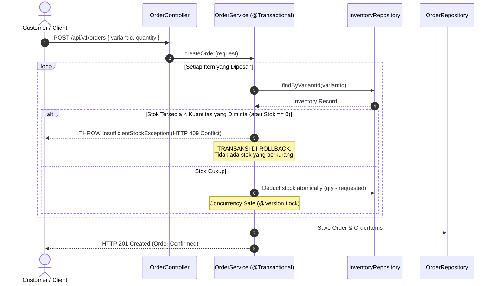

# Shop Warehouse Management System - RESTful API

[](https://openjdk.org/projects/jdk/17/)
[](https://spring.io/projects/spring-boot)
[](https://spring.io/projects/spring-security)
[%20%7C%20PostgreSQL-336791?logo=postgresql&logoColor=white)](https://www.h2database.com/)
[](http://localhost:8080/swagger-ui.html)
[](https://junit.org/)

> **Java Backend Developer Technical Assessment - GELI**  
> A robust, enterprise-grade RESTful API backend for managing shop warehouse inventory, item variants, flexible pricing, and orders with automated **out-of-stock prevention** and **stateless JWT authentication**.

---

## 📋 Daftar Isi

1. [Teknologi & Versi yang Digunakan](#-teknologi--versi-yang-digunakan)
2. [Panduan Cepat Setup & Menjalankan (Fresh Clone)](#-panduan-cepat-setup--menjalankan-fresh-clone)
3. [Akun Testing & Sample Data Bawaan](#-akun-testing--sample-data-bawaan)
4. [Dokumentasi Interaktif & Postman](#-dokumentasi-interaktif--postman)
5. [Arsitektur & Keputusan Desain (Design Decisions)](#-arsitektur--keputusan-desain-design-decisions)
6. [Mekanisme Pencegahan Penjualan Out-of-Stock](#-mekanisme-pencegahan-penjualan-out-of-stock)
7. [Daftar Endpoint API & Contoh cURL](#-daftar-endpoint-api--contoh-curl)
8. [Asumsi yang Dibuat (Assumptions Made)](#-asumsi-yang-dibuat-assumptions-made)
9. [Menjalankan Automated Tests](#-menjalankan-automated-tests)

---

## 🛠 Teknologi & Versi yang Digunakan

Aplikasi dibangun menggunakan teknologi backend modern standar industri:

| Komponen | Library / Framework | Versi | Keterangan |
|---|---|---|---|
| **Programming Language** | Java (JDK) | **17 LTS** | Memenuhi batasan teknis PDF (Java 17+) |
| **Framework** | Spring Boot | **3.3.5** | Versi stabil Spring Boot 3.x terbaru |
| **ORM / Persistence** | Spring Data JPA / Hibernate | **6.5.3.Final** | Abstraksi database & automasi relasi DDL |
| **Default Database** | H2 Database Engine | **2.2.224** | In-Memory (Zero-setup untuk kemudahan reviewer) |
| **Production Database** | PostgreSQL Driver | **42.7.4** | Driver resmi PostgreSQL (opsional profile `postgres`) |
| **Security & Auth** | Spring Security 6 | **6.3.4** | Proteksi endpoint berbasis role & filter chain |
| **Token Provider** | JJWT (Java JWT) | **0.12.6** | Stateless JWT HMAC-SHA256 Bearer Token |
| **Bean Validation** | Jakarta Validation (Hibernate Validator) | **3.0.2 / 8.0.1** | Validasi payload request DTO |
| **API Documentation** | Springdoc OpenAPI (Swagger 3 UI) | **2.6.0** | Dokumentasi interaktif via browser |
| **Productivity** | Project Lombok | **1.18.34** | Mengurangi boilerplate kode Java |
| **Build & Dependency Tool** | Apache Maven Wrapper (`mvnw`) | **3.9.x** | Siap dijalankan tanpa perlu instalasi Maven manual |
| **Testing** | JUnit 5, Mockito, MockMvc, AssertJ | **Latest** | Unit testing & full integration testing |

---

## 🚀 Panduan Cepat Setup & Menjalankan (Fresh Clone)

Ikuti langkah-langkah berikut ketika Anda baru saja meng-clone repository ini ke komputer lokal:

### 1. Prasyarat Sistem (*Prerequisites*)
- **Java 17 LTS atau lebih baru** sudah terpasang di komputer Anda.
  ```bash
  java -version
  ```
  *(Pastikan outputnya menunjukkan versi `17.x` atau lebih baru)*.
- **Git** untuk version control.
- *(Opsional)* **Postman** untuk pengujian API.

> **Catatan:** Anda **TIDAK PERLU** menginstal Apache Maven atau database PostgreSQL secara manual, karena project ini sudah dilengkapi **Maven Wrapper (`./mvnw`)** dan database **H2 In-Memory**.

---

### 2. Langkah Clone & Menjalankan Aplikasi

#### Step 1: Clone Repository
```bash
git clone <URL_REPOSITORY_ANDA>
cd test-geli
```

#### Step 2: Jalankan Aplikasi
Jalankan perintah ini di root folder proyek:

**Di macOS / Linux:**
```bash
./mvnw spring-boot:run
```

**Di Windows (Command Prompt / PowerShell):**
```cmd
mvnw.cmd spring-boot:run
```

#### Step 3: Verifikasi Bahwa Server Sudah Berjalan
Buka browser Anda dan akses:
- **Swagger UI**: [http://localhost:8080/swagger-ui.html](http://localhost:8080/swagger-ui.html)
- **H2 Database Console**: [http://localhost:8080/h2-console](http://localhost:8080/h2-console)
  - *JDBC URL*: `jdbc:h2:mem:warehousedb`
  - *Username*: `sa`
  - *Password*: *(kosongkan)*

---

### 3. *(Opsional)* Menjalankan Menggunakan PostgreSQL Lokal

Jika Anda ingin menjalankan aplikasi dengan database PostgreSQL lokal alih-alih H2:

1. Buat database di PostgreSQL Anda:
   ```sql
   CREATE DATABASE warehousedb;
   ```
2. Jalankan aplikasi dengan profile `postgres`:
   ```bash
   ./mvnw spring-boot:run -Dspring-boot.run.profiles=postgres
   ```
*(Kredensial default: user `postgres`, password `postgres` pada port `5432`. Dapat diubah via environment variable `SPRING_DATASOURCE_USERNAME` dan `SPRING_DATASOURCE_PASSWORD`)*.

---

## 👥 Akun Testing & Sample Data Bawaan

Saat pertama kali server dinyalakan, [`DataInitializer.java`](file:///Users/macbook/test-geli/src/main/java/com/geli/warehouse/config/DataInitializer.java) secara otomatis mengisi data awal berikut:

### 1. Kredensial Pengguna untuk Testing
| Username | Password | Role | Keterangan Hak Akses |
|---|---|---|---|
| **`tester`** | **`tester123`** | `ROLE_ADMIN` | **Akun utama testing**, akses penuh ke semua endpoint CRUD |
| `admin` | `admin123` | `ROLE_ADMIN` | Akun warehouse manager |
| `staff` | `staff123` | `ROLE_STAFF` | Akun staf gudang |
| `customer` | `customer123` | `ROLE_CUSTOMER` | Akun pelanggan toko |

### 2. Data Barang, Varian, Harga & Stok Pre-loaded
| Item SKU | Nama Barang | Variant SKU | Varian (Size / Warna) | Harga | Stok Fisik | Status Ketersediaan |
|---|---|---|---|---|---|---|
| `ITEM-TSHIRT` | Classic Cotton T-Shirt | `TSHIRT-BLK-M` | M / Black | $19.99 | 50 | ✅ **In Stock** |
| `ITEM-TSHIRT` | Classic Cotton T-Shirt | `TSHIRT-BLK-L` | L / Black | $19.99 | 30 | ✅ **In Stock** |
| `ITEM-TSHIRT` | Classic Cotton T-Shirt | `TSHIRT-WHT-M` | M / White | $18.99 | 3 | ⚠️ **Low Stock** (Threshold: 5) |
| `ITEM-TSHIRT` | Classic Cotton T-Shirt | `TSHIRT-WHT-XL` | XL / White | $21.99 | **0** | ❌ **OUT OF STOCK (Uji Tolak)** |
| `ITEM-SHOES` | Pro Running Shoes | `SHOES-GRY-42` | 42 / Grey | $89.99 | 15 | ✅ **In Stock** |
| `ITEM-SHOES` | Pro Running Shoes | `SHOES-GRY-43` | 43 / Grey | $89.99 | **0** | ❌ **OUT OF STOCK (Uji Tolak)** |
| `ITEM-SHOES` | Pro Running Shoes | `SHOES-BLU-42` | 42 / Blue | $94.99 | 8 | ✅ **In Stock** |
| `ITEM-BACKPACK`| Urban Canvas Backpack | `BAG-NVY` | Standard / Navy | $45.00 | 20 | ✅ **In Stock** |

---

## 📮 Dokumentasi Interaktif & Postman

### A. Swagger UI (Dokumentasi Browser)
Akses: **[http://localhost:8080/swagger-ui.html](http://localhost:8080/swagger-ui.html)**  
Anda dapat mencoba setiap endpoint langsung dari antarmuka web, mengklik tombol **Authorize** dan memasukkan Bearer Token JWT.

### B. Postman Collection & Environment
File siap pakai tersedia di folder [`postman/`](file:///Users/macbook/test-geli/postman):
- **Collection File**: [`postman/Shop_Warehouse_Management.postman_collection.json`](file:///Users/macbook/test-geli/postman/Shop_Warehouse_Management.postman_collection.json)
- **Environment File**: [`postman/Shop_Warehouse_Local.postman_environment.json`](file:///Users/macbook/test-geli/postman/Shop_Warehouse_Local.postman_environment.json)

#### Cara Pakai di Postman:
1. Buka Postman, klik **Import** di kiri atas, lalu pilih kedua file di atas.
2. Di pojok kanan atas Postman, pilih environment: **`Shop Warehouse - Local Environment`**.
3. Jalankan request: **`1. Authentication -> Login as Tester`** lalu klik **Send**. Token otomatis tersimpan ke environment.
4. Semua request berikutnya di folder `Items`, `Variants`, `Inventory`, dan `Orders` siap dijalankan tanpa perlu copy-paste token manual!

---

## 🏗 Arsitektur & Keputusan Desain (Design Decisions)

Aplikasi ini menerapkan **Clean Layered Architecture** standar industri enterprise backend:

```
src/main/java/com/geli/warehouse/
├── common/
│   ├── exception/        # GlobalExceptionHandler & custom business exceptions
│   └── response/         # Standard envelope ApiResponse<T>
├── config/               # Swagger OpenAPI config & DataInitializer (Seeder)
├── controller/           # REST Controller (/api/v1/...)
├── dto/
│   ├── request/          # Request payloads + Jakarta Bean Validation
│   └── response/         # Decoupled response contracts
├── model/
│   ├── entity/           # JPA Entities (User, Item, ItemVariant, Inventory, Order, OrderItem)
│   └── enums/            # Role, ItemStatus, OrderStatus, StockOperation
├── repository/           # Spring Data JPA Repositories
├── security/             # Spring Security 6, JWT Token Provider & Filter
└── service/              # Service interfaces & @Transactional business logic
```

### Keputusan Desain Utama:
1. **Decoupled DTO Pattern**: Domain Entity database tidak pernah diekspos langsung ke controller. Request dan response menggunakan DTO untuk mencegah *over-fetching*, *mass assignment vulnerability*, dan *circular dependency JSON*.
2. **Standard API Response Envelope**: Semua response konsisten dibungkus dalam format:
   ```json
   {
     "success": true,
     "message": "Success",
     "data": { ... },
     "timestamp": "2026-10-18T10:00:00Z"
   }
   ```
3. **Stateless JWT Security**: Menggunakan token JWT Bearer (HMAC-SHA256). Pengguna publik/customer dapat melihat katalog produk dan melakukan checkout order, sedangkan manajemen stok dan master barang dilindungi khusus untuk staf dan admin.
4. **Optimistic Concurrency Control**: Entity `Inventory` dilengkapi anotasi `@Version` untuk menjamin tidak terjadi *race condition* dan *overselling* saat banyak order masuk bersamaan.
5. **Clean & Readable Code**: Mengutamakan kode yang *self-documenting* melalui penamaan kelas, method, dan variabel yang ekspresif tanpa komentar yang berlebihan.

---

## 🛡 Mekanisme Pencegahan Penjualan Out-of-Stock

Persyaratan inti PDF berbunyi: *"A way to prevent selling items that are out of stock"*.

Berikut adalah alur logika yang diimplementasikan pada [`OrderServiceImpl.java`](file:///Users/macbook/test-geli/src/main/java/com/geli/warehouse/service/impl/OrderServiceImpl.java):



---

## 🌐 Daftar Endpoint API & Contoh cURL

Base URL: `http://localhost:8080`

### 1. Autentikasi (`/api/v1/auth`)

#### A. Login (Mendapatkan Bearer JWT Token)
```bash
curl -X POST http://localhost:8080/api/v1/auth/login \
  -H "Content-Type: application/json" \
  -d '{
    "username": "tester",
    "password": "tester123"
  }'
```
*Respons Sukses:*
```json
{
  "success": true,
  "message": "Login successful",
  "data": {
    "accessToken": "eyJhbGciOiJIUzI1NiIsInR5cCI6IkpXVCJ9...",
    "tokenType": "Bearer",
    "expiresIn": 86400000,
    "userId": 3,
    "username": "tester",
    "role": "ROLE_ADMIN"
  }
}
```

---

### 2. Katalog Barang (`/api/v1/items`)

#### A. Ambil Semua Barang (Publik)
```bash
curl -X GET http://localhost:8080/api/v1/items
```

#### B. Cari Barang Berdasarkan Kata Kunci (Keyword Search)
```bash
curl -X GET "http://localhost:8080/api/v1/items?keyword=t-shirt"
```

#### C. Tambah Barang Baru beserta Varian & Stok Awal (Auth)
```bash
curl -X POST http://localhost:8080/api/v1/items \
  -H "Authorization: Bearer <TOKEN_ANDA>" \
  -H "Content-Type: application/json" \
  -d '{
    "sku": "ITEM-HOODIE",
    "name": "Heavy Fleece Zip Hoodie",
    "description": "Warm winter fleece hoodie",
    "basePrice": 59.99,
    "variants": [
      {
        "sku": "HOODIE-BLK-L",
        "variantName": "Black - Large",
        "size": "L",
        "color": "Black",
        "price": 59.99,
        "initialStock": 40,
        "reorderThreshold": 5
      }
    ]
  }'
```

---

### 3. Varian Barang (`/api/v1/variants`)

#### A. Tambah Varian Baru ke Barang ID 1 (Auth)
```bash
curl -X POST http://localhost:8080/api/v1/items/1/variants \
  -H "Authorization: Bearer <TOKEN_ANDA>" \
  -H "Content-Type: application/json" \
  -d '{
    "sku": "TSHIRT-RED-M",
    "variantName": "Red - Medium",
    "size": "M",
    "color": "Red",
    "price": 19.99,
    "initialStock": 15,
    "reorderThreshold": 5
  }'
```

---

### 4. Manajemen Stok Gudang (`/api/v1/inventory`)

#### A. Cek Peringatan Stok Menipis (Low Stock Alerts)
```bash
curl -X GET http://localhost:8080/api/v1/inventory/low-stock
```

#### B. Cek Daftar Barang yang Habis (Out of Stock)
```bash
curl -X GET http://localhost:8080/api/v1/inventory/out-of-stock
```

#### C. Inisialisasi Stok Varian via POST (Auth)
```bash
curl -X POST http://localhost:8080/api/v1/inventory \
  -H "Authorization: Bearer <TOKEN_ANDA>" \
  -H "Content-Type: application/json" \
  -d '{
    "variantId": 1,
    "quantity": 50,
    "reorderThreshold": 10,
    "notes": "Direct stock initialization"
  }'
```

#### D. Restock Barang (Operasi: ADD, DEDUCT, atau SET) (Auth)
```bash
curl -X PUT http://localhost:8080/api/v1/inventory/variant/1 \
  -H "Authorization: Bearer <TOKEN_ANDA>" \
  -H "Content-Type: application/json" \
  -d '{
    "operation": "ADD",
    "quantity": 25,
    "notes": "Restock dari pengiriman supplier"
  }'
```

---

### 5. Checkout & Penjualan (`/api/v1/orders`)

#### A. Pemesanan Normal (Barang Tersedia)
```bash
curl -X POST http://localhost:8080/api/v1/orders \
  -H "Content-Type: application/json" \
  -d '{
    "customerName": "Alice Smith",
    "customerEmail": "alice@example.com",
    "items": [
      {
        "variantId": 1,
        "quantity": 2
      }
    ]
  }'
```
*Respons: HTTP 201 Created (Stok varian 1 otomatis berkurang 2 unit).*

#### B. Uji Coba Pencegahan Out-of-Stock (Barang Habis)
Coba pesan Varian ID 4 (`TSHIRT-WHT-XL` yang stoknya sengaja 0):
```bash
curl -X POST http://localhost:8080/api/v1/orders \
  -H "Content-Type: application/json" \
  -d '{
    "customerName": "Bob Miller",
    "customerEmail": "bob@example.com",
    "items": [
      {
        "variantId": 4,
        "quantity": 1
      }
    ]
  }'
```
*Respons: **HTTP 409 Conflict** (Pesanan otomatis ditolak dan transaksi dibatalkan):*
```json
{
  "success": false,
  "message": "Cannot fulfill order for variant 'White - XL' [SKU: TSHIRT-WHT-XL] (OUT OF STOCK). Requested: 1, Available: 0",
  "timestamp": "2026-10-18T10:05:00Z"
}
```

---

## 📌 Asumsi yang Dibuat (Assumptions Made)

1. **Pelacakan Stok pada Level Varian (SKU)**: Pada sistem gudang modern, unit stok fisik dilacak pada level varian (kombinasi ukuran dan warna tertentu), bukan pada produk induk yang bersifat abstrak.
2. **Prioritas Penetapan Harga**: Harga jual utama ditentukan pada tingkat varian (`variant.price`). Produk induk menyimpan `basePrice` untuk referensi umum katalog.
3. **Aksesibilitas Checkout**: Endpoint checkout (`POST /api/v1/orders`) terbuka untuk umum/customer, sedangkan manipulasi data master dan mutasi stok memerlukan autentikasi role Staf/Admin.
4. **Isolasi Database In-Memory**: Menggunakan database H2 in-memory sebagai default sesuai izin di PDF agar evaluator tidak perlu menginstal software tambahan saat memeriksa kode.

---

## 🧪 Menjalankan Automated Tests

Seluruh skenario pengujian unit dan integrasi dapat dijalankan dengan perintah:

```bash
./mvnw clean test
```

### Lingkup Pengujian:
- **`OrderServiceTest`**: Pengujian unit kalkulasi total order, deduksi stok, dan penolakan saat stok habis atau tidak mencukupi.
- **`OrderIntegrationTest`**: Pengujian integrasi end-to-end pemesanan via MockMvc (mengecek HTTP 201 vs HTTP 409 Conflict).
- **`AuthIntegrationTest`**: Pengujian integrasi registrasi user dan login untuk mendapatkan JWT Bearer token.
- **`WarehouseApplicationTests`**: Pengujian inisialisasi Spring Application Context.

Hasil test:
```text
[INFO] Tests run: 8, Failures: 0, Errors: 0, Skipped: 0
[INFO] BUILD SUCCESS
```
