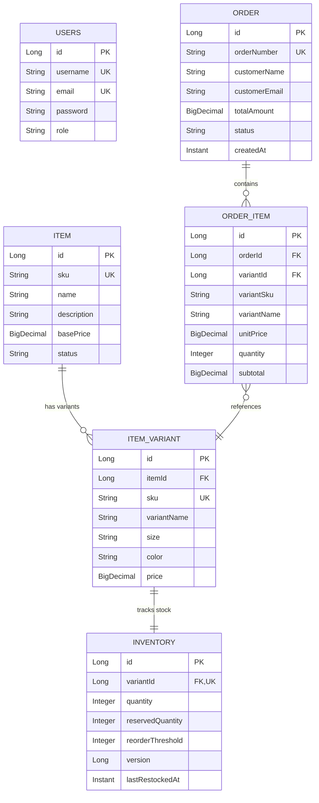

# Shop Warehouse Management System - RESTful API

[](https://www.oracle.com/java/)
[](https://spring.io/projects/spring-boot)
[](https://spring.io/projects/spring-security)
[](https://www.h2database.com/)
[]()

> A robust, production-grade Spring Boot 3 backend system for managing a shop's warehouse inventory, item variants, dynamic pricing, and orders with automated **out-of-stock prevention**.

---

## Table of Contents
1. [Business Context & Requirements](#business-context--requirements)
2. [Key Highlights & Architectural Decisions](#key-highlights--architectural-decisions)
3. [Technology Stack](#technology-stack)
4. [Domain Model & ER Diagram](#domain-model--er-diagram)
5. [Out-of-Stock Prevention Mechanism](#out-of-stock-prevention-mechanism)
6. [Pre-seeded Sample Data](#pre-seeded-sample-data)
7. [Getting Started & How to Run](#getting-started--how-to-run)
8. [API Documentation (Swagger UI & H2 Console)](#api-documentation)
9. [API Endpoints & cURL Examples](#api-endpoints--curl-examples)
10. [Assumptions Made](#assumptions-made)
11. [Running Tests](#running-tests)

---

## Business Context & Requirements

This system satisfies the requirements outlined in the **Java Backend Developer Technical Assessment**:
- **Item Tracking**: Manage shop items with unique SKUs and catalog information.
- **Variant Tracking**: Items can have multiple variants (e.g., sizes, colors, material).
- **Flexible Pricing**: Prices are defined per variant with a fallback base price on the item.
- **Inventory Tracking**: Accurate stock level tracking for every item variant.
- **Out-of-Stock Prevention**: Order checkout automatically enforces inventory availability, atomically rejects orders when stock is insufficient, and prevents race-condition overselling.
- **CRUD Operations**: Comprehensive REST endpoints for Items, Variants, Inventory, Orders, and Authentication.
- **Data Persistence**: In-memory relational database (H2) with clean JPA domain modeling.

---

## Key Highlights & Architectural Decisions

The application follows an **industry-standard layered Clean Architecture**:

```
src/main/java/com/geli/warehouse/
├── common/             # Cross-cutting concerns (ApiResponse envelope, GlobalExceptionHandler)
├── config/             # Spring configuration (OpenAPI Swagger 3, DataInitializer)
├── controller/         # REST Controllers exposing versioned /api/v1 endpoints
├── dto/
│   ├── request/        # Request payload contracts with Jakarta Bean Validations
│   └── response/       # Immutable, decoupled response transfer objects
├── model/
│   ├── entity/         # JPA entities (Item, ItemVariant, Inventory, Order, OrderItem, User)
│   └── enums/          # Enumerations (Role, ItemStatus, OrderStatus, StockOperation)
├── repository/         # Spring Data JPA repositories with custom derived and JPQL queries
├── security/           # OAuth/JWT token provider, filter, and authentication manager
└── service/
    ├── impl/           # Business logic layer with @Transactional boundaries
    └── ...             # Service interfaces (loose coupling)
```

### Architectural Decisions
1. **Decoupled DTO Layer**: Domain entities are strictly isolated from API contracts using DTOs, preventing sensitive data exposure and cyclic serialization issues.
2. **Unified API Envelope**: All REST responses follow a standardized JSON envelope (`ApiResponse<T>`) containing `success`, `message`, `data`, and `timestamp`.
3. **Optimistic Concurrency Control**: The `Inventory` entity is equipped with JPA `@Version` to safeguard against race conditions during high-concurrency order placements.
4. **Stateless Authentication**: Secured with Spring Security 6 using JWT (HMAC-SHA256). Catalog browsing is publicly accessible while stock adjustments and catalog mutations require staff/admin authorization.
5. **Clean & Concise Code**: Avoids noisy, redundant comments. Code is self-documenting through expressive naming conventions and clean modular boundaries.

---

## Technology Stack

- **Java**: 17 LTS
- **Framework**: Spring Boot 3.3.5
- **ORM / Persistence**: Spring Data JPA & Hibernate 6.5
- **Database**: H2 In-Memory Database (zero external setup required)
- **Security**: Spring Security 6 & JJWT 0.12.6
- **Validation**: Jakarta Validation (Hibernate Validator)
- **Documentation**: Springdoc OpenAPI 2.6.0 (Swagger 3 UI)
- **Build Tool**: Maven Wrapper (`./mvnw`)
- **Testing**: JUnit 5, Mockito, Spring Boot Test, MockMvc

---

## Domain Model & ER Diagram



---

## Out-of-Stock Prevention Mechanism

Preventing out-of-stock sales is implemented at the core transactional boundary:
1. **Atomic Validation**: When `POST /api/v1/orders` is invoked, the `OrderService` executes within a `@Transactional` block.
2. **Stock Verification**: For every requested variant, available stock is computed as `quantity - reservedQuantity`.
3. **Rejection & Conflict Response**:
   - If `availableStock < requestedQuantity`, an `InsufficientStockException` is thrown immediately.
   - The global exception handler translates this into an **HTTP 409 Conflict** (or 400 Bad Request) with an explicit error message stating the variant SKU, available units, and requested units.
   - No inventory is deducted and no partial order is recorded.
4. **Concurrency Safety**: The `Inventory` entity utilizes `@Version` optimistic locking. If two requests attempt to purchase the last item simultaneously, only one succeeds and the second is safely rolled back.

---

## Pre-seeded Sample Data

Upon application startup, `DataInitializer` automatically seeds realistic sample data:

### 1. Default Users
| Username | Password | Role | Description |
|---|---|---|---|
| `admin` | `admin123` | `ROLE_ADMIN` | Full access (Warehouse manager) |
| `staff` | `staff123` | `ROLE_STAFF` | Inventory & item editing |

### 2. Pre-loaded Catalog & Stock
| Item SKU | Item Name | Variant SKU | Size / Color | Price | Stock | Stock Status |
|---|---|---|---|---|---|---|
| `ITEM-TSHIRT` | Classic Cotton T-Shirt | `TSHIRT-BLK-M` | M / Black | $19.99 | 50 | In Stock |
| `ITEM-TSHIRT` | Classic Cotton T-Shirt | `TSHIRT-BLK-L` | L / Black | $19.99 | 30 | In Stock |
| `ITEM-TSHIRT` | Classic Cotton T-Shirt | `TSHIRT-WHT-M` | M / White | $18.99 | 3 | Low Stock (Threshold: 5) |
| `ITEM-TSHIRT` | Classic Cotton T-Shirt | `TSHIRT-WHT-XL` | XL / White | $21.99 | **0** | **OUT OF STOCK** |
| `ITEM-SHOES` | Pro Running Shoes | `SHOES-GRY-42` | 42 / Grey | $89.99 | 15 | In Stock |
| `ITEM-SHOES` | Pro Running Shoes | `SHOES-GRY-43` | 43 / Grey | $89.99 | **0** | **OUT OF STOCK** |
| `ITEM-SHOES` | Pro Running Shoes | `SHOES-BLU-42` | 42 / Blue | $94.99 | 8 | In Stock |
| `ITEM-BACKPACK`| Urban Canvas Backpack | `BAG-NVY` | OneSize / Navy | $45.00 | 20 | In Stock |

---

## Getting Started & How to Run

### Prerequisites
- **Java 17+** installed (`java -version`)
- Git

### 1. Clone & Navigate
```bash
git clone <repository-url>
cd test-geli
```

### 2. Run the Application
The project includes the Maven Wrapper, so no external Maven installation is needed:

```bash
./mvnw spring-boot:run
```

The application starts on `http://localhost:8080`.

---

## API Documentation

### Interactive Swagger UI
Open your browser and navigate to:
```
http://localhost:8080/swagger-ui.html
```
You can test all endpoints directly, authenticate via the "Authorize" button using a Bearer token, and inspect schemas.

### H2 Database Web Console
Access the in-memory database console at:
```
http://localhost:8080/h2-console
```
- **JDBC URL**: `jdbc:h2:mem:warehousedb`
- **Username**: `sa`
- **Password**: *(leave blank)*

---

## API Endpoints & cURL Examples

### 1. Authentication

#### Register a new user
```bash
curl -X POST http://localhost:8080/api/v1/auth/register \
  -H "Content-Type: application/json" \
  -d '{
    "username": "warehouse_user",
    "email": "user@warehouse.com",
    "password": "password123",
    "role": "ROLE_STAFF"
  }'
```

#### Login to obtain JWT Token
```bash
curl -X POST http://localhost:8080/api/v1/auth/login \
  -H "Content-Type: application/json" \
  -d '{
    "username": "admin",
    "password": "admin123"
  }'
```

*Example Response:*
```json
{
  "success": true,
  "message": "Login successful",
  "data": {
    "accessToken": "eyJhbGciOiJIUzI1NiIsInR5cCI6IkpXVCJ9...",
    "tokenType": "Bearer",
    "expiresIn": 86400000,
    "userId": 1,
    "username": "admin",
    "role": "ROLE_ADMIN"
  },
  "timestamp": "2026-10-18T09:45:00Z"
}
```

---

### 2. Items & Catalog

#### Get all items (Public)
```bash
curl -X GET http://localhost:8080/api/v1/items
```

#### Search items by keyword
```bash
curl -X GET "http://localhost:8080/api/v1/items?keyword=t-shirt"
```

#### Create a new item with variants & stock (Requires Bearer Token)
```bash
curl -X POST http://localhost:8080/api/v1/items \
  -H "Authorization: Bearer <YOUR_TOKEN>" \
  -H "Content-Type: application/json" \
  -d '{
    "sku": "ITEM-HOODIE",
    "name": "Heavyweight Fleece Hoodie",
    "description": "Warm winter hoodie with kangaroo pocket",
    "basePrice": 49.99,
    "variants": [
      {
        "sku": "HOODIE-BLK-L",
        "variantName": "Black - Large",
        "size": "L",
        "color": "Black",
        "price": 49.99,
        "initialStock": 25,
        "reorderThreshold": 5
      }
    ]
  }'
```

---

### 3. Variants

#### Add a variant to an existing item
```bash
curl -X POST http://localhost:8080/api/v1/items/1/variants \
  -H "Authorization: Bearer <YOUR_TOKEN>" \
  -H "Content-Type: application/json" \
  -d '{
    "sku": "TSHIRT-RED-M",
    "variantName": "Red - Medium",
    "size": "M",
    "color": "Red",
    "price": 19.99,
    "initialStock": 15,
    "reorderThreshold": 5
  }'
```

---

### 4. Inventory & Stock Management

#### View all inventory levels
```bash
curl -X GET http://localhost:8080/api/v1/inventory
```

#### Check low stock alerts
```bash
curl -X GET http://localhost:8080/api/v1/inventory/low-stock
```

#### Check out-of-stock items
```bash
curl -X GET http://localhost:8080/api/v1/inventory/out-of-stock
```

#### Restock / Adjust inventory (ADD, DEDUCT, or SET)
```bash
curl -X PUT http://localhost:8080/api/v1/inventory/variant/4 \
  -H "Authorization: Bearer <YOUR_TOKEN>" \
  -H "Content-Type: application/json" \
  -d '{
    "operation": "ADD",
    "quantity": 20,
    "notes": "Restocked from supplier shipment"
  }'
```

---

### 5. Orders (Checkout & Out-of-Stock Prevention)

#### A. Successful Order Placement (Items in stock)
```bash
curl -X POST http://localhost:8080/api/v1/orders \
  -H "Content-Type: application/json" \
  -d '{
    "customerName": "Jane Doe",
    "customerEmail": "jane@example.com",
    "items": [
      {
        "variantId": 1,
        "quantity": 2
      }
    ]
  }'
```
*Response: HTTP 201 Created with order number and deducted inventory.*

#### B. Out-of-Stock Prevention Demonstration
Attempting to order an out-of-stock variant (e.g., variant ID 4 `TSHIRT-WHT-XL` which has 0 stock):
```bash
curl -X POST http://localhost:8080/api/v1/orders \
  -H "Content-Type: application/json" \
  -d '{
    "customerName": "Mark Spencer",
    "customerEmail": "mark@example.com",
    "items": [
      {
        "variantId": 4,
        "quantity": 1
      }
    ]
  }'
```

*Response: HTTP 409 Conflict*
```json
{
  "success": false,
  "message": "Cannot fulfill order for variant 'White - XL' [SKU: TSHIRT-WHT-XL] (OUT OF STOCK). Requested: 1, Available: 0",
  "timestamp": "2026-10-18T09:47:12Z"
}
```

---

## Assumptions Made

1. **Variant-level Stocking**: In modern warehouse management, physical inventory is tracked at the SKU/Variant level (specific size/color combination), as stock belongs to physical variant units rather than the abstract parent product.
2. **Pricing Precedence**: Each variant defines its specific selling price. The parent item defines a default `basePrice` for catalog reference.
3. **Checkout Experience**: Order placement (`POST /api/v1/orders`) is open to shop customers (public or authenticated), while stock management and catalog editing require staff/admin credentials.
4. **Data Isolation in H2**: In-memory H2 database is used as permitted in the assessment specification. For production deployment, switching to PostgreSQL or MySQL requires only updating the JDBC driver and connection properties in `application.yml`.

---

## Running Tests

Execute the automated test suite with Maven:

```bash
./mvnw clean test
```

All unit and integration tests (including the out-of-stock rejection integration test) will execute and report test outcomes.
